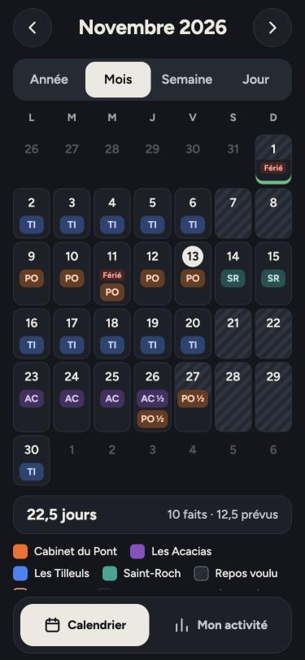
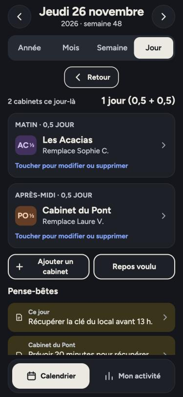
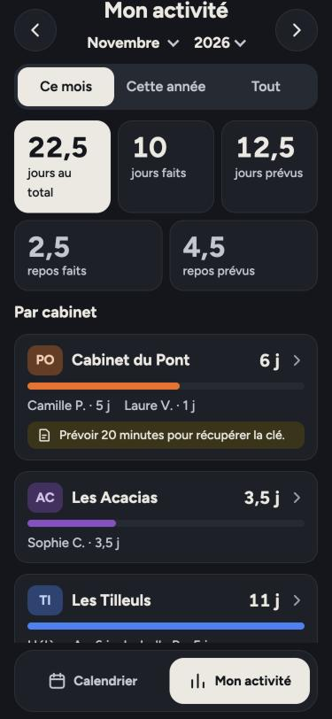
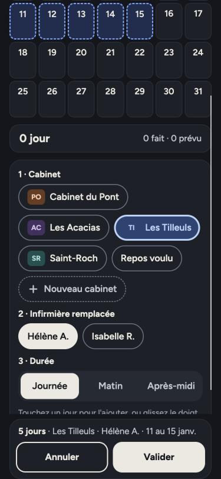

# Mon planning — planning de remplacements (SaaS)

Application de planning très simple, pensée pour l'iPhone, destinée à une infirmière libérale remplaçante
(3 à 5 cabinets par mois, plusieurs infirmières remplacées par cabinet). Elle remplace le calendrier papier.

- **Front** : Angular 22 (composants autonomes, signaux, sans zone.js), installable sur l'écran d'accueil (PWA).
- **API** : Symfony 7.4 LTS, Doctrine ORM, authentification JWT (LexikJWT), MySQL / MariaDB.
- **Aucune donnée de santé** : seulement des jours travaillés, des noms de cabinets et d'infirmières remplacées, des compteurs et des pense-bêtes libres.

Captures : [`docs/captures/`](docs/captures/) · Architecture : [`ARCHITECTURE.md`](ARCHITECTURE.md) · Décisions : [`DECISIONS.md`](DECISIONS.md) · Prototype validé : [`prototype/planning-v5.html`](prototype/planning-v5.html)

| Mois | Jour | Mon activité | Ajout par glisser |
|---|---|---|---|
|  |  |  |  |

## Arborescence

```
api/        API Symfony (src/, tests/, migrations/, data/vacances-scolaires.json)
web/        Front Angular (src/app/core = règles et services, calendar/, activity/, sheets/, shell/)
prototype/  Prototype HTML cliquable qui fait foi pour les écrans et les textes
docs/       Captures d'écran
composer.sh Lanceur Composer (contournement d'un bug de libcurl Homebrew, voir DECISIONS.md)
```

## Prérequis

PHP 8.4+ (extensions `pdo_mysql`, `intl`, `sodium`), Composer 2, Node 22+ et npm, MySQL 8 ou MariaDB 10.6+.

## Installation locale

```bash
cd api
../composer.sh install
```

Créer `api/.env.local` (jamais commité) :

```dotenv
APP_SECRET=<32 caractères hexadécimaux aléatoires>
JWT_PASSPHRASE=<phrase longue aléatoire>
DATABASE_URL="mysql://planning:<mot de passe>@127.0.0.1:3306/planning?serverVersion=8.0.32&charset=utf8mb4"
# Facultatif, pour les données de démonstration :
DEMO_PASSWORD=<mot de passe du compte demo@planning.test>
```

Puis :

```bash
php bin/console lexik:jwt:generate-keypair          # clés JWT dans config/jwt/ (ignorées par git)
php bin/console doctrine:database:create
php bin/console doctrine:migrations:migrate
php bin/console app:holidays:import                  # vacances scolaires depuis data/vacances-scolaires.json
php bin/console app:user:create prenom@exemple.fr    # le mot de passe est demandé de façon masquée
php bin/console doctrine:fixtures:load               # facultatif : données de démo (efface la base !)
```

Front :

```bash
cd web
npm ci
```

## Lancement en local

```bash
php -S 127.0.0.1:8000 -t api/public
```

```bash
npm --prefix web start
```

Ouvrir http://localhost:4200. Le serveur Angular relaie `/api` vers `http://127.0.0.1:8000` (`web/proxy.conf.json`) :
front et API sont vus sur la même origine, comme en production.

## Tests

```bash
cd api && php bin/phpunit
```

29 tests : connexion et jeton, mot de passe haché, limitation des tentatives, isolation entre utilisateurs,
règles repos / cabinet, annulation, suppression en cascade, compteurs. Base SQLite jetable (`.env.test`).

```bash
npm --prefix web test -- --watch=false
```

16 tests Vitest sur les règles de calcul : demi-journées, chevauchements, jours faits / prévus, jours fériés (Pâques), vacances par zone, dates en français.

## Mise à jour annuelle des vacances scolaires

Compléter `api/data/vacances-scolaires.json` avec les dates officielles (education.gouv.fr), puis :

```bash
php bin/console app:holidays:import
```

## Déploiement (piste AlwaysData, à confirmer)

Front et API servis **sur le même domaine** : pas de CORS en production, un seul certificat HTTPS.

1. `npm --prefix web run build` → copier `web/dist/web/browser/*` dans `api/public/` (à côté de `index.php`).
2. Envoyer `api/` par SFTP ou `git pull` en SSH, puis `../composer.sh install --no-dev --optimize-autoloader`.
3. Sur le serveur : `api/.env.local` avec `APP_ENV=prod`, les secrets, `DATABASE_URL` MariaDB (`serverVersion=10.11.x-MariaDB`), `CORS_ALLOW_ORIGIN` = l'adresse du site.
4. `php bin/console lexik:jwt:generate-keypair`, `doctrine:migrations:migrate`, `app:holidays:import`, `app:user:create`.
5. Racine du site = `api/public`, avec une réécriture : fichier existant → servi tel quel ; `/api/*` → `index.php` ; le reste → `index.html` (application Angular).
6. Sur l'iPhone : ouvrir le site dans Safari → Partager → « Sur l'écran d'accueil ».

Les étapes 3 à 6 seront validées lors de la mise en ligne (étape 3 du brief).
